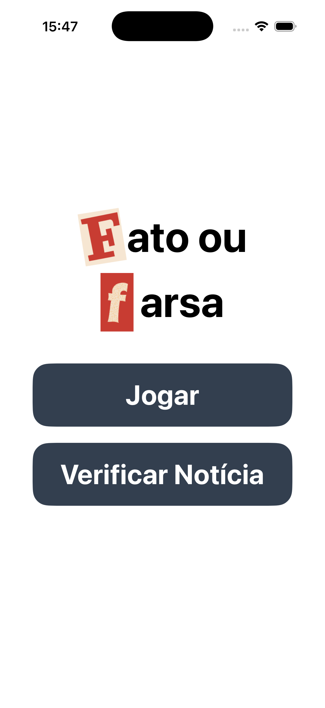
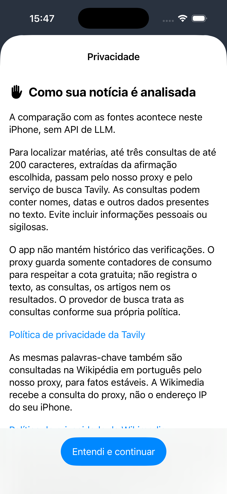
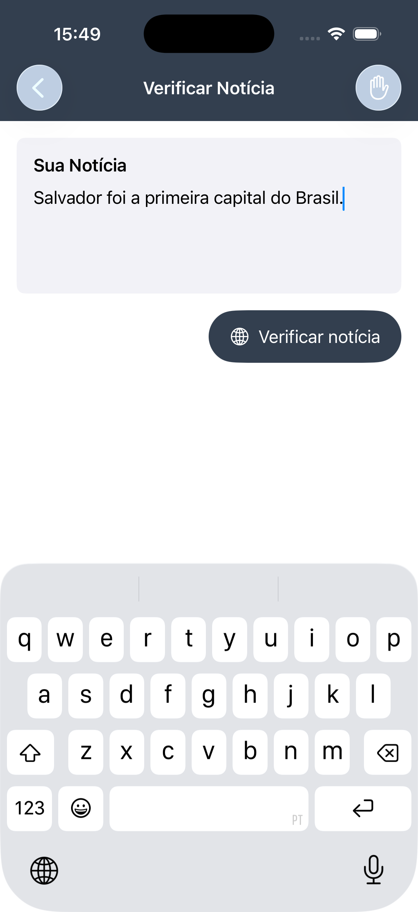
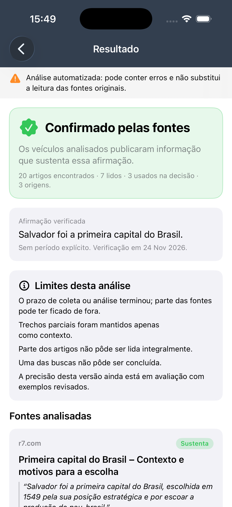
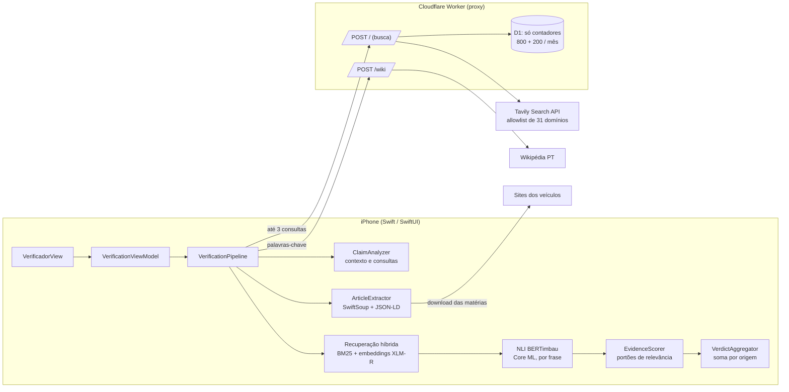
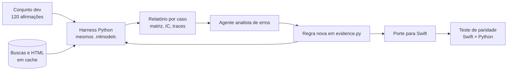

<p align="center"></p>

<h1 align="center">Fato ou Farsa</h1>

<p align="center">
App iOS de educação midiática com um <b>verificador de notícias que roda no próprio iPhone</b>:<br>
busca fontes confiáveis, lê as matérias e decide com modelos de NLP em Core ML, sem API de LLM e com custo de operação zero.
</p>

<p align="center">


</p>

<p align="center">




</p>
<p align="center"><sub>Início · aviso de privacidade · entrada · resultado de uma verificação real no simulador ("Salvador foi a primeira capital do Brasil." → confirmado por 3 origens independentes).</sub></p>

> **English summary.** Fato ou Farsa ("Fact or Fake") is a SwiftUI media-literacy app for Brazilian Portuguese speakers. It has a curated quiz, a Question of the Day with Siri/Shortcuts, and a news verifier. The verifier runs fully on-device: a Portuguese BERT NLI model (BERTimbau, fine-tuned locally) and multilingual sentence embeddings, both in Core ML. It searches an allowlist of trusted outlets through a Cloudflare Worker that guards the API key and a free monthly quota, adds Wikipedia, and reads the articles. It then turns sentence-level NLI scores into a sourced verdict with explicit relevance rules, so no LLM is involved. A Python harness replays the exact Core ML models over cached searches. On the 120-claim development set (not a gold benchmark), it measured the move from a policy that answered "conflicting sources" 64% of the time (24% accuracy) to the current one: 62% accuracy, 97% directional precision, 3 "conflicting" verdicts.

---

## Sumário

- [O problema e a solução](#o-problema-e-a-solução)
- [Arquitetura](#arquitetura)
- [Como o veredito é decidido](#como-o-veredito-é-decidido)
- [Resultados medidos](#resultados-medidos)
- [Tecnologias e como foram usadas](#tecnologias-e-como-foram-usadas)
- [Tecnologias avaliadas e descartadas](#tecnologias-avaliadas-e-descartadas)
- [Decisões de engenharia e trade-offs](#decisões-de-engenharia-e-trade-offs)
- [Como executar, testar e avaliar](#como-executar-testar-e-avaliar)
- [Estrutura do repositório](#estrutura-do-repositório)
- [Limitações e próximos passos](#limitações-e-próximos-passos)
- [Equipe e autoria](#equipe-e-autoria)

## O problema e a solução

Desinformação circula como frases curtas e confiantes. Quem recebe uma delas precisa saber **o que as fontes sérias dizem**, e não ouvir mais uma opinião automática. O app tem três partes:

- **Quiz curado** e **Pergunta do Dia** (com Siri e Atalhos) para praticar a identificação de boatos.
- **Verificador de notícias**: a pessoa digita uma afirmação. O app busca matérias em uma lista fixa de veículos, agências de checagem e órgãos públicos (a Wikipédia já está integrada, mas aguarda ajuste antes de entrar em produção). Ele lê os textos e responde **Confirmado**, **Contradito**, **Fontes divergentes**, **Sem informação suficiente** ou **Não encontrado**, sempre com os trechos e os links que sustentam a resposta.

Restrições assumidas desde o início:

| Restrição | Como foi atendida |
|---|---|
| Sem API paga de LLM | NLI (inferência textual) e embeddings em **Core ML no iPhone**; o texto explicativo é determinístico |
| Custo de operação ≈ 0 | Busca Tavily na **cota gratuita** (1.000/mês), com teto atômico em Cloudflare D1; Wikipédia gratuita |
| Privacidade | Nenhum histórico; o proxy guarda **apenas contadores**; a chave da API nunca vai para o app |
| Hardware real | Modelo escolhido por medição em iPhone físico: pico de RAM de 383 MB e ~69 ms por par NLI (Spike 9) |

## Arquitetura



O ciclo de desenvolvimento usa as mesmas peças fora do aparelho:



`VerificationPipeline` é o único coordenador. Os serviços dependem de protocolos, e a inferência roda fora da main thread num `actor`. O orçamento é monotônico: 11 s de rede dentro de 15 s no total, até 8 artigos e 48 pares NLI curtos.

## Como o veredito é decidido

**Em linguagem simples.** O app procura matérias que tratem da mesma coisa que a afirmação e lê frase por frase. Um modelo de linguagem treinado em português diz se cada frase confirma, contradiz ou não tem relação com a afirmação. Uma frase só conta se falar dos mesmos nomes, números e termos específicos. Cada veículo vota uma vez. "Fontes divergentes" aparece só quando veículos diferentes discordam de verdade.

**Em detalhe.**

1. **Consultas.** A frase escolhida vira até três consultas de ≤200 caracteres. Datas relativas são resolvidas localmente e "checagem" só entra como consulta de resgate. A Wikipédia pode ser consultada em paralelo, sem gastar crédito (integrada; ainda não ativada em produção, ver Limitações).
2. **Leitura.** JSON-LD é lido antes de limpar o HTML, seguido de extração no estilo Readability com SwiftSoup. Paywall declarado não é contornado, e snippet ou conteúdo parcial nunca decide sozinho.
3. **Recuperação.** Janelas de 128 tokens ranqueadas por BM25 + similaridade de embeddings (fusão RRF). Das melhores janelas saem as **frases-premissa**: título e frases, sem créditos de foto, perguntas nem alternativas de múltipla escolha.
4. **NLI.** BERTimbau-base com cabeça de 3 classes (entailment / neutral / contradiction), INT8, `.cpuOnly`, com contagem real de tokens WordPiece.
5. **Portões de evidência** (`EvidenceScorer`). O NLI sozinho lê "mesmo enquadramento, outro fato" como contradição. Por isso uma passagem só vota em formas reconhecíveis:
   - **apoio** com os mesmos nomes (correspondência exata), números e palavras específicas. A especificidade é medida pela raridade no vocabulário do tokenizador, sem modelo extra;
   - **refutação** pelo mesmo sujeito com outro atributo ("…não foi capital"), pelo mesmo predicado com outro sujeito ("Júpiter é o maior planeta" refuta "Marte é…"), por outro número ou por posição em ranking contra um superlativo;
   - **checagens**: a frase que relata o boato ("circula nas redes…") não é apoio, e o título da agência que desmente vira refutação.
6. **Agregação** (`VerdictAggregator`). Cada origem editorial conta uma vez, e republicações não somam. O peso é 1,0 para enciclopédia/fonte primária, 1,1 para agência de checagem e 0,8 para jornalismo. DIVERGENTE exige ≥2 origens com força comparável no lado minoritário.

Exemplo real do relatório do harness (afirmação falsa *"O Plano Real foi lançado em 2004."*):

```text
[gov.br|primary] E0.00 N0.00 C1.00  R1.00  ['numeric_mismatch']
  "O Plano Real foi lançado em julho de 1994, e ainda hoje, dez anos depois, …"
```

Na v0.5, a mesma frase era descartada por "período incompatível" (matéria de 2004 sobre um fato de 1994). Hoje ela vale como refutação por número divergente.

## Resultados medidos

Conjunto **de desenvolvimento**, `evaluation/data/dev_claims.jsonl`: 120 afirmações (40 fatos triviais verdadeiros, 36 triviais falsos, 22 boatos e 22 notícias do quiz). Mesma coleta de busca e mesmos modelos nas duas colunas; intervalos de Wilson 95%.

| Métrica | v0.5 (antes) | v3 (atual) |
|---|---|---|
| Acerto | 24,2% (17,4–32,6) | **61,7%** (52,7–69,9) |
| Respostas "Fontes divergentes" | 77 de 120 | **3** de 120 |
| Erros de direção oposta (confirmar o falso / negar o verdadeiro) | 5 | **2** |
| Precisão quando o app decide | 85,3% (29/34) | **97,4%** (74/76) |
| Cobertura (afirmações com veredito decisivo) | 28% | **63%** |

> **Leia com cuidado.** Os rótulos desse conjunto foram rascunhados durante o desenvolvimento e aguardam revisão humana. As regras foram ajustadas olhando esses mesmos casos, então isso **não é** um benchmark cego nem uma estimativa de precisão geral. O protocolo de avaliação que vale para promoção está em [`evaluation/README.md`](Minotaur-s/evaluation/README.md): 1.200 afirmações com dois revisores, 300 em teste cego e gates em iPhone físico. Detalhes, experimentos descartados e o que falta medir estão em [`IMPLEMENTATION_STATUS.md`](Minotaur-s/evaluation/IMPLEMENTATION_STATUS.md).

## Tecnologias e como foram usadas

| Tecnologia | Onde | Por quê / como |
|---|---|---|
| **SwiftUI**, Swift Concurrency | App inteiro | `actor` para inferência, `TaskGroup` para busca e leitura concorrentes com prazo monotônico |
| **Core ML** (INT8, `.cpuOnly`) | `NLIService`, `EmbeddingService` | Inferência local; pesos >100 MB versionados em partes e verificados por SHA-256 no build |
| **BERTimbau-base** + PLUE/MNLI | NLI | Base nativa em português, ajustada localmente no Mac (6 h 29 min, R$ 0); macro-F1 0,817 no dev do PLUE |
| **paraphrase-multilingual-MiniLM-L12-v2** | Embeddings / recuperação | Similaridade de frases; a tabela de unigramas do tokenizador XLM-R mede a raridade das palavras |
| **BM25 + RRF** (Swift puro, Accelerate) | `HybridRetrieval` | Preserva nomes e números que os embeddings diluem |
| **SwiftSoup**, JSON-LD | `ArticleExtractor` | Extração do corpo, datas, autoria e detecção de paywall/preview |
| **Cloudflare Workers + D1** | `proxy/` | Guarda a chave, força parâmetros de custo e reserva cota de forma atômica (800 produção + 200 avaliação) |
| **Tavily Search API** | Busca | Busca oficial restrita à allowlist, sem respostas geradas por LLM |
| **API da Wikipédia (MediaWiki)** | Rota `/wiki` + `WikipediaSearchService` | Fonte enciclopédica gratuita para fatos estáveis, sem expor o IP do usuário |
| **Python, coremltools, tokenizers** | `evaluation/harness/` | Roda **os mesmos `.mlmodelc`** do app para medir regras sem gastar créditos |
| **PyTorch, Transformers, Hugging Face** | `spikes/`, `train_nli_v2.py` | Conversão, paridade de logits e treino local |
| **uv** | Ambientes Python | Ambientes reproduzíveis com lockfile para harness, spikes e treino |
| **Swift Testing**, `node:test` | Testes | 175 testes Swift (inclui paridade Swift × Python em 120 passagens reais), 16 testes do Worker, 15 de avaliação |
| **Claude Code** (subagentes, skills, sessões paralelas) | Desenvolvimento | Sessões paralelas para a conversão do MiniLM, a rota `/wiki` e o script de retreino. Skill [`avaliar-verificador`](Minotaur-s/.claude/skills/avaliar-verificador/SKILL.md) e agente [`analista-erros-verificador`](Minotaur-s/.claude/agents/analista-erros-verificador.md) versionados |

## Tecnologias avaliadas e descartadas

| Tecnologia | Decisão | Motivo |
|---|---|---|
| API de LLM (GPT, Claude etc.) | Fora do escopo | Custo recorrente, latência de rede e privacidade; o veredito precisa ser explicável pelas fontes |
| mDeBERTa-v3 | Descartado | Converte para Core ML mas **não executa** no iPhone (Spikes 2/2c) |
| BERTimbau-large | Descartado | Pico de 1,1–1,3 GB de RAM, acima do teto de 1 GB (Spike 8) |
| Ensemble com MiniLMv2-L6 | Descartado após medição | Não melhorou o acerto e aumentou erros de direção oposta; +103 MB (Spike 10) |
| Negação automática da afirmação | Descartado | Piorou todos os modelos testados (Spike 7) |
| Scraping do DuckDuckGo | Descartado | Bloqueio de bot em Python e em `URLSession` (Spikes 4/4b) |
| LangChain / LangGraph / LangSmith | Descartados | Orquestram e rastreiam LLMs; aqui não há LLM, e o LangSmith receberia o texto das consultas |
| n8n, pgvector, Docker | Descartados | Exigiriam servidor ou banco hospedado; Core ML só roda em macOS e não em contêiner |
| Claude Agents SDK, Cline | Descartados | Custo de API à parte ou duplicação do agente já usado |
| Ollama (LLM local) | Planejado, só em desenvolvimento | Rotular pares de notícias para o retreino; nunca no app |

## Decisões de engenharia e trade-offs

- **No aparelho em vez de servidor.** Privacidade e custo zero em troca de modelos pequenos (≤ ~400 MB de RAM) e do cuidado com prazo: Core ML síncrono não é interrompível, então o prazo é verificado entre inferências.
- **Validar no hardware antes de medir qualidade.** O mDeBERTa batia logits no desktop e travava no iPhone. Desde então, a ordem dos filtros é converter → executar no aparelho → medir qualidade.
- **Regras explícitas sobre o NLI.** Um modelo de 82% de acurácia em 24–48 pares produz contradições espúrias quase sempre. Os portões de relevância tornam cada voto auditável no trace e mantêm o "porquê" do veredito ligado a uma frase de uma fonte.
- **Medir antes de mudar.** Um harness que reproduz o app em Python sobre buscas cacheadas permitiu testar dezenas de variações sem gastar cota. Cada regra nova nasceu de erros concretos do relatório, e as que pioraram o resultado foram revertidas.
- **Duas implementações, um contrato.** As regras vivem em Python (referência) e em Swift (app). Um teste gerado a partir de passagens reais garante que as duas dão o mesmo resultado.
- **Cota gratuita como requisito.** O Worker força `basic`, sem respostas geradas, e reserva crédito por tentativa. Se o D1 ficar indisponível, a busca é bloqueada em vez de gastar sem controle.

O histórico completo dos experimentos (pergunta → experimento → resultado → decisão) está em [`docs/decisoes-tecnicas.md`](Minotaur-s/docs/decisoes-tecnicas.md).

## Como executar, testar e avaliar

Requisitos: macOS com Xcode 27 (testado com 27.0), iOS 17+ (simulador ou aparelho). Node 20+ para o proxy e [`uv`](https://docs.astral.sh/uv/) para o harness.

```sh
git clone <repo> && cd Minotaur-s/Minotaur-s
open Minotaur-s.xcodeproj            # o build remonta e verifica os pesos Core ML sozinho
```

Os pesos (>100 MB) ficam fatiados em `model-parts/`; para remontar à mão, rode `bash scripts/sync-models.sh`. Não execute `xcodegen generate`: o `project.yml` não representa todas as configurações do projeto versionado.

Os comandos abaixo partem de `Minotaur-s/Minotaur-s/`.

```sh
# Testes Swift (simulador)
xcodebuild test -project Minotaur-s.xcodeproj -scheme Minotaur-s \
  -destination 'platform=iOS Simulator,name=iPhone 17 Pro' -only-testing:Minotaur-sTests

# Proxy (SQLite em memória, sem rede)
(cd proxy && npm ci && npm test)

# Ferramentas de avaliação
(cd evaluation && python3 -m unittest discover -s . -p 'test_*.py')

# Harness offline: reanalisa o conjunto dev com os mesmos modelos do app
cd evaluation/harness && uv sync
HARNESS_OFFLINE=1 .venv/bin/python run_dev.py analyze --mode sentence --run meu-teste
HARNESS_OFFLINE=1 .venv/bin/python run_dev.py report --run meu-teste --aggregator v3
```

O modo offline precisa do cache local de buscas (`evaluation/snapshots/`, fora do Git). Gerá-lo exige a credencial da faixa de avaliação do proxy; ver [`evaluation/README.md`](Minotaur-s/evaluation/README.md).

## Estrutura do repositório

```text
Minotaur-s/Minotaur-s/          pasta do projeto Xcode
├── Minotaur-s/                 app iOS
│   ├── Views/Verificador/      telas do verificador, aviso de privacidade
│   ├── Services/Verificador/   pipeline, busca, extração, recuperação, NLI, evidência, agregação
│   ├── Models/Verificador/     tipos de domínio (contexto, evidência, resultado, domínios confiáveis)
│   └── Resources/              modelos Core ML, tokenizadores, manifesto de versões
├── Minotaur-sTests/            Swift Testing (inclui paridade com o harness)
├── proxy/                      Cloudflare Worker + D1 (busca, cota, /wiki)
├── evaluation/                 conjunto dev, harness offline, treino/calibração/gates
├── spikes/                     experimentos 01–10, cada um com RESULTADO.md
├── docs/decisoes-tecnicas.md   resumo das decisões
├── .claude/                    skill de avaliação e agente analista de erros
└── spec.md                     especificação vigente (v0.6)
```

## Limitações e próximos passos

- **Avaliação.** O conjunto dev é pequeno (120), foi usado para ajustar as regras e aguarda revisão humana. O corpus de 1.200 afirmações com dois revisores e teste cego ainda não existe.
- **Cobertura.** Em ~37% das afirmações o app responde "Sem informação suficiente". O comum é a busca não trazer uma frase que afirme ou negue o fato.
- **Erros do NLI.** Trocas de papel ("a Terra gira em torno do Sol" lida como apoio a "o Sol gira em torno da Terra") e qualificadores ("a capital com maior transparência"). O próximo passo é o retreino com pares do domínio de notícias (script pronto em `evaluation/train_nli_v2.py`).
- **Wikipédia.** Integrada no app e no Worker, e medida no conjunto dev: o artigo inteiro piorou (73/120, 9 "divergentes"). Só a introdução ficou em 75/120, mas o caso "A Terra é plana" virou "divergente", porque o NLI leu "Terra plana é uma concepção arcaica…" como apoio. Por isso a rota não foi implantada. Próximo passo: introdução apenas, mais marcadores de descrédito enciclopédico. Detalhes em [`IMPLEMENTATION_STATUS.md`](Minotaur-s/evaluation/IMPLEMENTATION_STATUS.md).
- **Hardware.** A latência com 48 pares curtos e a RAM do pipeline novo ainda precisam do gate em iPhone físico (16 e 13).
- **Distribuição.** Validação Release/Siri, URL pública de privacidade e política automatizada de robots.txt pendentes.

## Equipe e autoria

<!-- Preencher: integrantes, papéis e créditos. Não gerado automaticamente. -->

_Seção a preencher pela equipe: integrantes, papel de cada pessoa (design, quiz, Pergunta do Dia/Siri, verificador, proxy, avaliação) e contexto do projeto._

## Privacidade

Textos e resultados ficam só na memória da sessão; apenas consultas curtas, derivadas da afirmação escolhida, saem do aparelho. Não há API de inferência remota, publicidade, tracking nem coleta de verificações para treino. Artigos são abertos nos sites das fontes, com trechos curtos e atribuição. Os serviços envolvidos têm suas próprias políticas: [Tavily](https://www.tavily.com/privacy), [Cloudflare](https://www.cloudflare.com/privacypolicy/), [Wikimedia](https://foundation.wikimedia.org/wiki/Policy:Privacy_policy).
